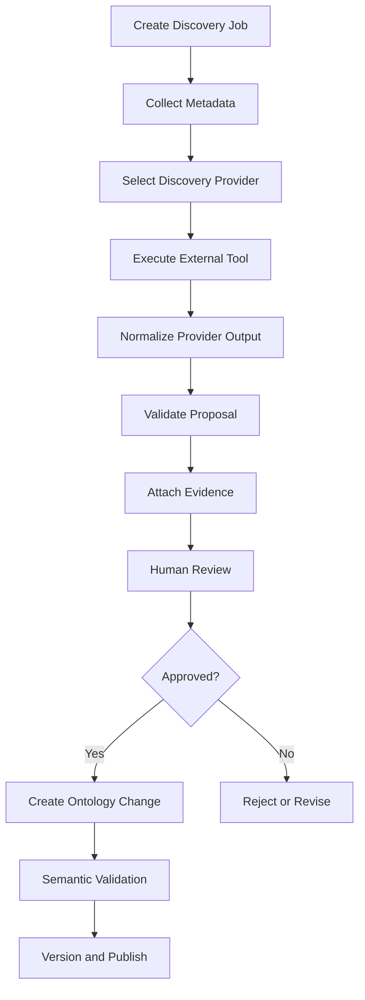

# ADR-0003: 外部工具通过 Adapter 和 Provider 集成

- Status: Accepted for MVP design
- Date: 2026-11-21
- Decision Owners: P1 Architecture
- Scope: External Integration

## 1. Context

P1 需要连接外部 LLM、本体发现工具、数据源连接器、Protégé 以及身份认证系统。

这些系统拥有不同的接口、部署方式、认证机制和版本更新周期。

直接在核心服务中调用外部系统专有 API，会增加替换成本和系统耦合。

## 2. Decision

所有外部工具通过明确的 Adapter 或 Provider 接口接入。

主要接口包括：

| Interface | Responsibility |
|---|---|
| LLMProvider | Model invocation |
| DiscoveryProvider | Ontology discovery |
| DataSourceConnector | Metadata collection |
| OntologyFormatAdapter | Standard format import/export |
| IdentityProvider | Authentication integration |
| ObjectStorageProvider | File and artifact storage |
| MessageBrokerAdapter | Background task messaging |

外部实现可以是 Python Package、独立 HTTP 服务或受控容器。

## 3. Trust Boundary

外部工具属于非可信执行边界。

必须遵循：

1. 外部工具不能直接写入正式本体资产。
2. 所有输出必须经过 Schema 校验。
3. 发现结果应转换为 P1 Proposal。
4. 结果必须关联来源、任务和证据。
5. 正式本体变更必须经过授权审核。
6. 外部进程的网络、文件和资源访问必须受限。

## 4. Discovery Workflow

## 5. Version and Compatibility

Each adapter must record:

- Provider name
- Provider version
- API version
- Configuration schema version
- Authentication method
- Timeout and retry configuration
- Supported output format
- Dependency licenses

Adapter contract tests are required before upgrading an external provider.

## 6. Alternatives

### Direct Vendor Integration

Rejected for core business logic because it introduces vendor-specific coupling.

### Standard Adapter Contract

Accepted because it allows different implementations to be selected without redesigning the platform workflow.

## 7. Validation

- [ ] One provider can be replaced by another without changing core ontology services.
- [ ] Provider output is validated.
- [ ] Provider failures do not corrupt formal ontology assets.
- [ ] Every proposal has provenance information.
- [ ] Provider versions and licenses are recorded.
- [ ] External credentials are managed securely.

## 8. Status

Accepted for the MVP architecture design.
