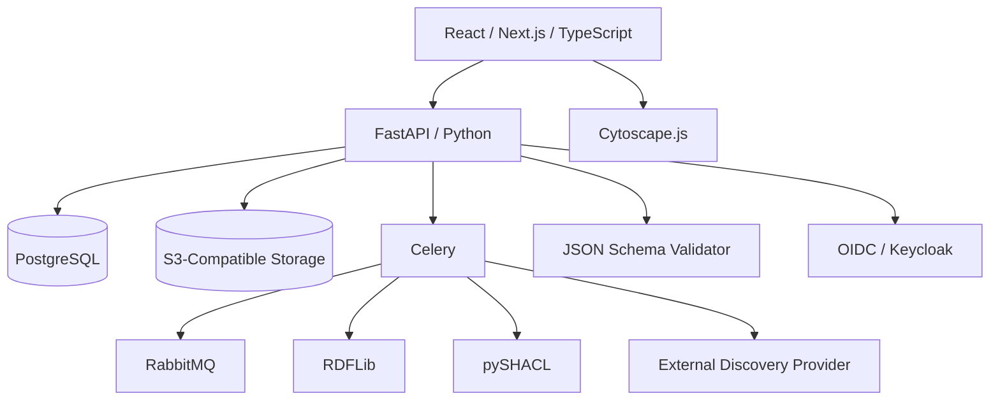

# P1 Dependency Map

- Document Version: V1.0
- Date: 2026-11-21
- Status: Dependency Design Baseline
- Scope: MVP Runtime and Development Dependencies

## 1. Dependency Management Principles

1. Every direct dependency must have a declared version.
2. Transitive dependencies must be captured in lockfiles and SBOM.
3. Every distributed component must have a recorded license.
4. Container images must use pinned tags and preferably immutable digests.
5. External services must be replaceable through adapters where practical.
6. Production dependencies require security and license review.
7. Version upgrades must pass compatibility and regression tests.

The version references below are a research baseline, not a production lockfile. Exact patch versions and container digests must be frozen when the repository build is created.

## 2. Core Dependency Inventory

| Component | Suggested Baseline | Role | License / Terms | Notes |
|---|---|---|---|---|
| React | 19.3 | Frontend UI | MIT | UI library |
| Next.js | 16.4.6 | Frontend framework | MIT | Pin patch version |
| TypeScript | Pin at project setup | Frontend language | Apache-2.0 | Lock compiler version |
| FastAPI | 0.165.0 | Backend API | MIT | Python >= 3.11 |
| Python | 3.12.x or tested supported release | Backend runtime | PSF License | Pin runtime image |
| PostgreSQL | 18.7 baseline | Primary database | PostgreSQL License | Evaluate PostgreSQL 19 compatibility |
| Celery | 5.7.0 | Background task framework | BSD-3-Clause | Broker configured separately |
| RabbitMQ | Stable supported release, pinned by image digest | Message Broker | MPL-2.0 | Preferred initial broker |
| Redis | Optional, exact version subject to license review | Cache / optional broker | Version-dependent | Do not assume all Redis versions use BSD |
| Valkey | Evaluate compatible release | Optional cache / datastore | BSD-3-Clause | Test client and broker compatibility |
| RDFLib | 7.6.0 | RDF processing | BSD-3-Clause | Parser, serializer, graph APIs |
| pySHACL | 0.40.2 | SHACL validation | Apache-2.0 | Validate supported feature set |
| JSON Schema | Draft 2020-12 | Structure validation standard | Specification; runtime validator separately licensed | Keep schema dialect explicit |
| Cytoscape.js | 3.35.0 | Graph visualization | MIT | Graph UI |
| Keycloak | Stable supported release, pinned at deployment | OIDC / IAM | Apache-2.0 | Optional integration |
| S3 API | Provider-specific | Object storage interface | Provider-specific | Keep storage adapter |
| MinIO Community | Pin exact source tag/commit if used | Self-hosted S3-compatible storage | AGPL-3.0 | Source-only distribution; review before redistribution |
| NVIDIA Auto Ontology | Evaluate release/container tag 1.2.0 | External discovery provider | Apache-2.0; review bundled notices | Optional integration |
| Protégé | Version recorded in interoperability test matrix | External ontology editor | Review distribution and plugin terms | Integrate through file formats, not required runtime dependency |

## 3. Version Reference Notes

### Frontend

- React current documentation lists 19.3.
- Next.js release history lists 16.4.6.
- Both projects use MIT licenses.

### Backend

- FastAPI 0.165.0 was published on PyPI on 2026-11-18 and lists MIT licensing.
- FastAPI declares Python >= 3.11.
- Python runtime version should be frozen in the backend container image.

### Database

PostgreSQL 19.0 was released on 2026-11-19.

For the initial compatibility baseline, PostgreSQL 18.7 is a conservative choice while the team verifies driver, migration and backup compatibility with PostgreSQL 19.

PostgreSQL uses the PostgreSQL License.

### Task Queue

Celery 5.7.0 is the current stable documentation line.

Celery supports RabbitMQ and Redis as stable broker transports.

RabbitMQ server uses MPL-2.0.

Redis licensing depends on its version:
- Redis 7.2 and earlier: BSD-3-Clause
- Redis 7.4: RSALv2 or SSPLv1
- Redis 8 and later: RSALv2, SSPLv1 or AGPLv3

For a commercial product, check the exact Redis version and license obligations before bundling or redistributing it.

Valkey is an alternative datastore released under BSD-3-Clause. Its compatibility with the exact Celery client and broker configuration must be tested before production use.

### Semantic Processing

RDFLib 7.6.0 uses BSD-3-Clause.

pySHACL 0.40.2 uses Apache-2.0.

The JSON Schema 2020-12 dialect is the selected structure validation baseline. The license of the runtime validator library must be recorded separately.

### Graph Visualization

Cytoscape.js 3.35.0 uses MIT.

### Identity

Keycloak uses Apache-2.0. It is an optional OIDC provider integration and should not become a required dependency for local development.

### Object Storage

P1 should depend on an S3-compatible storage interface.

MinIO Community is AGPLv3 and is now distributed as source code only. Organizations should complete license and distribution review before including it in a commercial or proprietary deployment.

A managed S3 service or another compatible implementation can be selected without changing the P1 storage contract.

### External Discovery

NVIDIA Auto Ontology is licensed under Apache-2.0. Its repository lists third-party dependencies and container-specific notices. These notices must be included in the integration review.

## 4. Dependency Relationship Map

## 5. License Compliance Workflow

Before a release:

1. Export direct dependency manifests.
2. Resolve all transitive dependencies.
3. Generate SBOM in a standard format such as SPDX or CycloneDX.
4. Scan licenses and identify incompatible terms.
5. Review container image licenses and notices.
6. Verify bundled external tools and model runtime terms.
7. Store the review result with the release evidence.
8. Repeat after material dependency upgrades.

## 6. Security and Upgrade Workflow

Every dependency upgrade should include:

- Release notes review
- Security advisory review
- License review
- Dependency compatibility tests
- API and integration regression tests
- Container image rebuild
- SBOM regeneration

Unmaintained or unsupported dependencies must be reviewed and replaced according to project risk.

## 7. Initial Exclusions

The following are not required MVP dependencies:

- Dedicated graph database
- Dedicated RDF triple store
- Vector database
- Kafka
- Kubernetes
- Distributed service mesh

They may be introduced after a measurable technical or operational requirement is identified.

## 8. Acceptance Checklist

- [ ] Direct runtime dependencies have version declarations.
- [ ] Lockfiles are committed.
- [ ] Container images are pinned.
- [ ] Licenses are recorded.
- [ ] Transitive dependencies are included in SBOM.
- [ ] External tools have their own dependency and license review.
- [ ] Redis licensing is checked against the exact selected version.
- [ ] MinIO Community licensing is reviewed before distribution.
- [ ] Upgrade procedures are documented.

## 9. Status

This document records the proposed dependency baseline. It is not a substitute for the generated lockfiles, SBOM, legal review or production compatibility test results.
