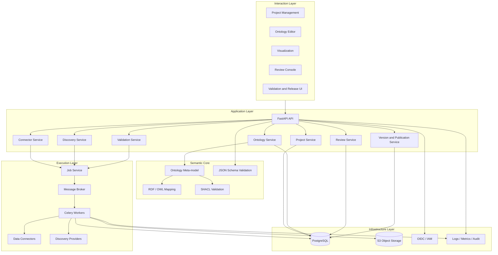
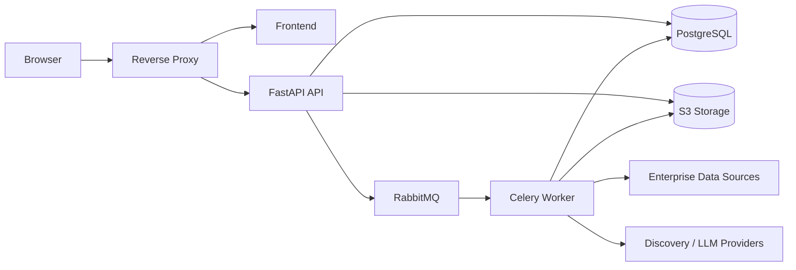

# P1 Architecture Overview

- Product: P1 Ontology Engineering Platform
- Document Version: V1.0
- Date: 2026-11-21
- Status: Architecture Design Baseline
- Scope: P1 MVP and extensible target architecture

## 1. Architecture Goals

P1 provides an industry-agnostic platform for ontology and semantic asset engineering.

The platform supports the following lifecycle:

1. Project and domain initialization
2. Data source connection
3. Metadata collection
4. AI-assisted ontology discovery
5. Candidate review and editing
6. Ontology modeling
7. Semantic validation
8. Version management
9. Publication and export
10. Audit and traceability

The architecture must support:

- Modular development
- Standards interoperability
- Replaceable external components
- Traceable semantic assets
- Private deployment
- Explicit security boundaries
- Incremental evolution

## 2. Architecture Principles

| ID | Principle | Description |
|---|---|---|
| AP-01 | Industry Agnostic | Domain ontologies are managed as assets |
| AP-02 | Modular | Modules have explicit responsibilities and interfaces |
| AP-03 | Standards First | RDF, OWL, SHACL, SKOS and JSON Schema |
| AP-04 | Replaceable Components | External systems are integrated through adapters |
| AP-05 | Traceability | Evidence, review, validation and release records |
| AP-06 | Security by Design | Authentication, authorization, isolation and audit |
| AP-07 | Private Deployment | Support customer-controlled environments |
| AP-08 | Incremental Evolution | Modular monolith first, selective service extraction later |

## 3. Logical Architecture



The diagram describes logical dependencies. It does not prescribe one process per module.

## 4. Deployment Architecture

MVP deployment:



Suggested deployment units:

| Unit | Deployment |
|---|---|
| Frontend | Container |
| API | Container |
| Worker | One or more containers |
| PostgreSQL | Container for development; managed or dedicated service for production |
| Message Broker | RabbitMQ |
| Object Storage | S3-compatible service |
| Identity Provider | Optional OIDC provider |
| Reverse Proxy | Nginx or equivalent |

Docker Compose is sufficient for the initial development and demonstration environment. Production deployment requirements should determine whether Kubernetes or another orchestrator is necessary.

## 5. Module Boundaries

| Module | Responsibility | Owns |
|---|---|---|
| MOD-01 Project | Projects, domains and memberships | Project entities |
| MOD-02 Ontology Core | Ontology, classes, properties, relations | Semantic entities |
| MOD-03 Editor | Model editing and change submission | Editing commands |
| MOD-04 Connector | Source connection configuration | Connector configuration |
| MOD-05 Metadata | Metadata snapshots and assets | Metadata records |
| MOD-06 Discovery | Discovery task orchestration | Discovery jobs and proposals |
| MOD-07 Review | Proposal review and evidence | Review records |
| MOD-08 Validation | Structural and semantic validation | Validation rules and reports |
| MOD-09 Version | Version snapshots and diffs | Version records |
| MOD-10 Publication | Export and publication | Export artifacts |
| MOD-11 Visualization | Ontology graph visualization | Graph query models |
| MOD-12 IAM and Audit | Permissions and audit events | Roles and audit records |
| MOD-13 Jobs and Observability | Background jobs and execution status | Job metadata |

Modules should not directly manipulate each other's internal database tables. Cross-module operations should use application-level interfaces.

## 6. Semantic Core

The semantic core uses a platform-level ontology meta-model.

The internal model should represent at least:

- Ontology
- Namespace
- Class
- Property
- Relation
- Constraint
- Term
- External Mapping
- Evidence Reference
- Version Reference

### 6.1 Validation Responsibilities

| Validation Layer | Responsibility |
|---|---|
| Pydantic | API request and response validation |
| JSON Schema | Persisted JSON configuration and interchange payload structure |
| Internal Meta-model | Referential integrity and platform-level semantic rules |
| RDFLib | RDF parsing, graph transformation and serialization |
| pySHACL | SHACL graph constraint validation |
| OWL tooling | Optional reasoning and ontology consistency checks |

OWL reasoning should be introduced according to concrete use cases and computational requirements. It should not be assumed that a SHACL validation pass proves all OWL logical consistency requirements.

### 6.2 Format Interoperability

Supported target formats:

- RDF/XML
- Turtle
- JSON-LD
- OWL
- SHACL
- JSON Schema

Each importer/exporter must define:

- Supported format version
- Supported constructs
- Unsupported constructs
- Conversion warnings
- Round-trip test coverage

A conversion report must be generated when information may be lost.

## 7. Integration Contracts

External systems must be integrated through explicit interfaces.

### 7.1 Data Source Connector

```python
from typing import Protocol, Any

class DataSourceConnector(Protocol):
    def validate_connection(self, config: dict[str, Any]) -> None:
        ...

    def collect_metadata(
        self,
        config: dict[str, Any],
        scope: dict[str, Any],
    ) -> dict[str, Any]:
        ...

    def health_check(self, config: dict[str, Any]) -> dict[str, Any]:
        ...
```

### 7.2 Discovery Provider

```python
from typing import Protocol, Any

class DiscoveryProvider(Protocol):
    def discover(
        self,
        source_snapshot: dict[str, Any],
        options: dict[str, Any],
    ) -> dict[str, Any]:
        ...

    def health_check(self) -> dict[str, Any]:
        ...
```

Provider output must be normalized into P1 proposal objects. A provider must not directly publish or overwrite formal ontology assets.

### 7.3 Format Adapter

```python
from typing import Protocol, Any

class OntologyFormatAdapter(Protocol):
    def import_ontology(
        self,
        content: bytes,
        options: dict[str, Any],
    ) -> dict[str, Any]:
        ...

    def export_ontology(
        self,
        ontology: dict[str, Any],
        options: dict[str, Any],
    ) -> bytes:
        ...
```

An adapter must return structured errors and conversion warnings.

## 8. Asynchronous Job Model

Long-running tasks must be executed asynchronously.

Job states:

- PENDING
- QUEUED
- RUNNING
- SUCCEEDED
- FAILED
- RETRYING
- CANCELLED

Every job must include:

- job_id
- project_id
- job_type
- input_reference
- status
- attempt_count
- started_at
- finished_at
- error_code
- error_message
- result_reference

Tasks must support idempotency keys, timeouts, retries with limits and cancellation where technically possible.

## 9. Security Architecture

### Authentication
Use application-managed authentication for the MVP or integrate an OIDC provider.

### Authorization
Enforce project-level permissions in backend services. Frontend visibility is not an authorization boundary.

### Connector Security
- Read-only by default
- Least-privilege credentials
- Secret references instead of plaintext secrets
- Network destination allowlists where feasible
- Egress controls
- Connection audit

### File Security
- File type and size validation
- Archive expansion limits
- Isolated parsing
- XML external entity protections
- No unrestricted remote resource resolution

### AI Security
- Treat model output as untrusted input
- Validate provider output against schemas
- Preserve evidence and provenance
- Require authorized review before publication

### Tenant and Project Isolation
All project-owned records must carry project scope. Backend queries must enforce scope checks. Database row-level security can be added as defense in depth.

## 10. Observability

Record the following:

- API request and error logs
- Job execution status
- Connector execution logs
- Model invocation metadata
- Validation results
- Publication events
- Authorization decisions
- Audit events

Do not place secrets, complete sensitive documents or raw credentials in logs.

## 11. Evolution Strategy

### Phase 1: MVP
Modular monolith, asynchronous workers, PostgreSQL, S3-compatible storage and standards adapters.

### Phase 2: Capability Expansion
More connectors, discovery providers, advanced semantic validation, enterprise IAM and better observability.

### Phase 3: Selective Service Extraction
Extract discovery, connector or validation services only when independent scaling, runtime or organizational requirements justify the cost.

## 12. Acceptance Checklist

- [ ] Architecture modules have explicit ownership.
- [ ] Cross-module interfaces are documented.
- [ ] Semantic core is independent of external discovery engines.
- [ ] RDF/OWL/SHACL import and export tests exist.
- [ ] Long-running tasks are asynchronous.
- [ ] AI outputs are treated as proposals.
- [ ] Project permissions are enforced in the backend.
- [ ] Connector credentials are not stored in plaintext.
- [ ] Dependency versions and licenses are recorded.
- [ ] Deployment configuration is reproducible.
- [ ] Architecture decisions are recorded as ADRs.

## 13. Status

This document is an architecture design baseline. It does not imply that the listed modules, integrations or deployment units have been implemented or accepted.
