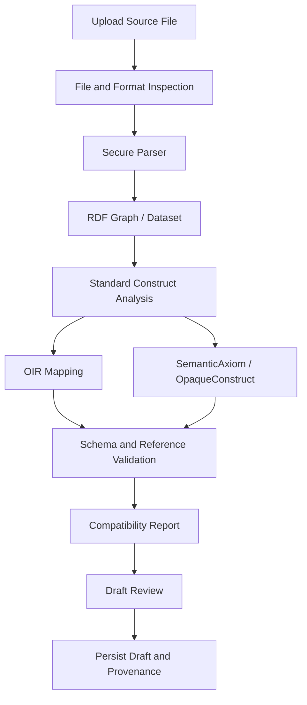
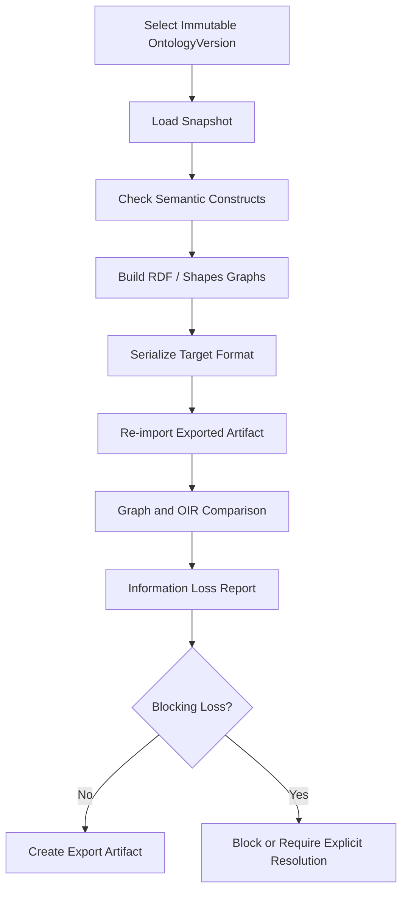

# P1 Ontology Format Mapping Specification

- Document: `docs/ontology/format-mapping.md`
- Version: V1.0
- Date: 2026-11-21
- Status: Design Baseline
- Scope: JSON / RDF / OWL / SHACL / SKOS interoperability

## 1. Purpose

定义 P1 内部 Ontology Meta-model 与外部语义标准之间的映射、导入、导出、验证和兼容性策略。

核心原则：

1. 内部 OIR 是 P1 工程管理的统一模型。
2. RDF 是主要的图语义交换基础。
3. OWL、SHACL、SKOS 各自保留原有标准职责。
4. 标准适配器负责转换，不将外部标准强制压缩成简单 JSON 对象。
5. 无法完整映射的语义构造必须保留或明确拒绝，禁止静默丢弃。
6. 转换必须生成可追溯的兼容性和信息损失报告。

## 2. Supported Standards and Responsibilities

| Standard | Responsibility | P1 Usage |
|---|---|---|
| JSON | Structured data interchange | API payloads and snapshots |
| JSON Schema | JSON structure validation | Meta-model contracts |
| RDF 1.1 | Graph data model | Semantic graph interchange |
| OWL 2 | Ontology and logical axioms | Formal ontology representation |
| SHACL | RDF graph constraints | Data and semantic quality checks |
| SKOS | Knowledge organization systems | Terminology and controlled vocabularies |

OWL is a language, not a file extension. A file named `.owl` must be inspected to identify its actual syntax.

For OWL 2 tool interoperability, RDF/XML is the required exchange syntax. Turtle is an important RDF serialization and should also be supported by P1.

## 3. Internal Representation

P1 uses an internal Ontology Intermediate Representation (OIR).

OIR contains:

- Ontology
- OntologyVersion
- OntologyClass
- DatatypeProperty
- ObjectProperty
- Relation
- Constraint
- Term
- Alias
- SemanticAxiom
- OpaqueConstruct
- SourceReference

### 3.1 SemanticAxiom

Represents a formal semantic axiom that does not have a dedicated first-class P1 object.

Suggested fields:

| Field | Meaning |
|---|---|
| id | Internal UUID |
| ontologyVersionId | Owning version |
| axiomKind | Axiom category |
| expressionAst | Structured expression, when supported |
| referencedIris | Referenced semantic entities |
| annotations | Axiom annotations |
| sourceFormat | Original syntax |
| sourceArtifactRef | Original source reference |

### 3.2 OpaqueConstruct

Preserves a construct that the current OIR mapper cannot fully interpret.

Suggested fields:

| Field | Meaning |
|---|---|
| id | Internal UUID |
| ontologyVersionId | Owning version |
| sourceFormat | Original format |
| graphRef | Source RDF graph artifact |
| closureRef | Stored subgraph closure |
| rootReference | Import-scoped root node reference |
| sha256 | Content integrity |
| supportStatus | Preserved / unsupported |
| conversionNotes | Compatibility notes |

An opaque construct must not be silently dropped during export.

Blank-node identifiers are source-graph scoped. They must not be treated as portable semantic identifiers.

## 4. Mapping Matrix

| OIR Object | RDF / OWL Mapping | Additional Handling |
|---|---|---|
| Ontology | `owl:Ontology` | Ontology IRI and version metadata |
| OntologyClass | `owl:Class` | Class IRI |
| Class parent | `rdfs:subClassOf` | Named or anonymous class expression |
| DatatypeProperty | `owl:DatatypeProperty` | `rdfs:domain`, `rdfs:range` |
| ObjectProperty | `owl:ObjectProperty` | Domain, range, inverse and characteristics |
| Relation | ObjectProperty reference | UI-level relationship projection; not automatically an instance assertion |
| Constraint | Applicable OWL axiom, if semantically equivalent | SHACL Shape for data-quality constraints |
| Term | RDF resource / `skos:Concept` | Concept scheme mapping |
| Preferred label | `rdfs:label` or `skos:prefLabel` | Preserve language tag |
| Alias | `skos:altLabel` | Preserve language and alias type |
| Definition | `rdfs:comment` or `skos:definition` | Preserve source vocabulary |
| Evidence | Separate provenance graph or P1 metadata | Optional PROV-O mapping |
| Release | Version and publication metadata | P1 release record |

Do not automatically convert every P1 Constraint to an OWL axiom. A data-quality rule such as mandatory field presence is usually a SHACL constraint.

## 5. Mapping Examples

### 5.1 Class

OIR:

```json
{
  "id": "internal-uuid",
  "iri": "https://example.org/customer#Customer",
  "preferredLabels": [
    {"value": "Customer", "language": "en"},
    {"value": "客户", "language": "zh-CN"}
  ]
}
```

RDF/OWL:

```turtle
ex:Customer a owl:Class ;
    rdfs:label "Customer"@en ;
    rdfs:label "客户"@zh-CN .
```

### 5.2 Datatype Property

```turtle
ex:customerId
    a owl:DatatypeProperty ;
    rdfs:domain ex:Customer ;
    rdfs:range xsd:string .
```

### 5.3 Object Property

```turtle
ex:hasOrder
    a owl:ObjectProperty ;
    rdfs:domain ex:Customer ;
    rdfs:range ex:Order .
```

A P1 Relation referencing this ObjectProperty is a modeling projection. It does not itself assert that a particular Customer instance has a particular Order instance.

An instance assertion would be:

```turtle
ex:customer001 ex:hasOrder ex:order001 .
```

### 5.4 SHACL Constraint

```turtle
ex:CustomerShape
    a sh:NodeShape ;
    sh:targetClass ex:Customer ;
    sh:property [
        sh:path ex:customerId ;
        sh:minCount 1 ;
        sh:datatype xsd:string
    ] .
```

### 5.5 SKOS Term

```turtle
ex:CustomerConcept
    a skos:Concept ;
    skos:prefLabel "Customer"@en ;
    skos:prefLabel "客户"@zh-CN ;
    skos:altLabel "Client"@en .
```

## 6. Import Architecture



Import requirements:

1. Preserve the original source file.
2. Compute SHA-256 for the original artifact.
3. Record the declared and detected format.
4. Use a format allowlist.
5. Do not dereference arbitrary network resources.
6. Parse into RDF Graph or Dataset.
7. Map recognized constructs to OIR.
8. Preserve unsupported but parseable subgraphs.
9. Produce a conversion report.
10. Save the result as a draft, not a published version.

## 7. Export Architecture



Export must be deterministic for the same version, adapter version and configuration where the target format permits it.

Export metadata must include:

- Ontology ID and Version ID
- Target format
- Serializer name and version
- Adapter version
- Export timestamp
- Content hash
- Conversion report reference
- Unsupported construct count

## 8. Format Registry

MVP format registry:

| Format ID | Typical Extension | RDFLib Format | MVP |
|---|---|---|---|
| turtle | `.ttl` | `turtle` | Supported |
| rdfxml | `.rdf`, `.xml`, `.owl` | `xml` | Supported |
| ntriples | `.nt` | `nt` | Supported |
| jsonld | `.jsonld` | `json-ld` | Controlled support |
| nquads | `.nq` | `nquads` | Later |
| trig | `.trig` | `trig` | Later |
| owlxml | `.owx` | Dedicated adapter | Later |
| manchester | `.omn` | Dedicated adapter | Later |

File extension alone must not determine the parser. The import request should record the selected parser format and any detected-format discrepancy.

JSON-LD contexts must be local or allowlisted. Arbitrary remote context retrieval is disabled by default.

## 9. Namespace and IRI Policy

P1 distinguishes:

- Ontology IRI
- Version IRI
- Entity IRI
- Named Graph IRI
- Internal UUID
- Source-native ID

Prefix bindings are presentation aliases. Changing a prefix does not change the underlying IRI.

Namespace registry records:

- prefix
- namespace IRI
- project ID
- ontology ID
- purpose
- status
- primary flag

Prefix collisions may be resolved by changing prefixes. IRI changes require an explicit migration and ChangeRecord.

## 10. Blank Nodes and Complex OWL Constructs

Blank nodes are local to an RDF graph or document scope and are not persistent global identifiers.

Rules:

1. Do not use a parsed blank-node label as an internal UUID.
2. Retain source graph context.
3. Preserve the subgraph closure required by an anonymous expression.
4. Do not merge blank nodes from independent source documents by label.
5. Do not skolemize without an explicit policy and mapping record.
6. Compare graphs using RDF graph isomorphism rather than blank-node label equality.

Complex OWL restrictions and nested class expressions must be represented as SemanticAxiom, structured expression AST or OpaqueConstruct.

## 11. Conversion Status

Every mapped construct must receive one status:

| Status | Meaning | Default |
|---|---|---|
| EXACT | Semantics mapped completely | Allow |
| NORMALIZED | Semantics preserved with canonicalization | Allow with note |
| PRESERVED | Original construct retained but not fully modeled | Allow storage; inspect before release |
| UNSUPPORTED | Cannot parse or preserve safely | Block |

A warning is required whenever a construct is normalized or retained opaquely.

A release must not silently omit a semantic construct.

## 12. Validation Strategy

### Structural Validation
JSON Schema and Pydantic validate OIR object structure.

### Reference Validation
P1 validates internal IDs, project ownership, target object types and version references.

### RDF Validation
RDF parser and graph checks validate syntax and selected RDF-level invariants.

### SHACL Validation
Data Graph and Shapes Graph are passed to a SHACL processor. The processor returns a conformance result and Validation Report.

### OWL Validation
An OWL-capable tool validates supported OWL constructs and performs reasoning when required.

SHACL success is not proof of OWL logical consistency. OWL consistency is not proof of business data completeness.

## 13. Round-trip Test Strategy

### RDF Serialization Test

1. Parse source RDF.
2. Serialize to another syntax.
3. Parse serialized output.
4. Compare graphs by graph isomorphism.

### OIR Round-trip Test

1. Import source graph.
2. Map supported constructs to OIR.
3. Retain unsupported constructs.
4. Export OIR.
5. Re-import exported file.
6. Compare supported object structure and preserved constructs.

### OWL Semantic Test

For selected logical constructs, run a compatible OWL reasoner and verify expected entailments or consistency results.

Do not claim full logical equivalence based only on RDF graph comparison.

### Dataset Test

When named graphs are involved, compare graph identifiers and each graph's internal structure. Do not flatten all named graphs into one default graph unless the import contract explicitly requires it.

## 14. Information Loss Report

Each import/export operation should produce:

```json
{
  "operationId": "uuid",
  "sourceFormat": "rdfxml",
  "targetFormat": "turtle",
  "mappedConstructCount": 0,
  "normalizedConstructCount": 0,
  "preservedOpaqueConstructCount": 0,
  "unsupportedConstructCount": 0,
  "warnings": [],
  "blockingIssues": [],
  "status": "completed"
}
```

Counts are runtime values, not fixed product performance claims.

## 15. Security

- Limit upload size and archive expansion.
- Use parser allowlists.
- Disable arbitrary external URL access.
- Disable unrestricted `owl:imports`.
- Restrict JSON-LD context resolution.
- Harden XML parsing against XXE.
- Run untrusted parsers in isolated workers.
- Record original file hash and parser version.
- Never log credentials or sensitive document content.

## 16. Initial Acceptance Criteria

- [ ] RDF/Turtle import and export are supported.
- [ ] RDF/XML import and export are supported.
- [ ] OWL declarations for classes and properties map to OIR.
- [ ] SHACL Shapes can be loaded and validated.
- [ ] SKOS labels and concepts can be imported/exported.
- [ ] Namespace prefixes do not alter entity IRIs.
- [ ] Blank-node labels are not used as stable IDs.
- [ ] Unsupported OWL constructs are preserved or blocked.
- [ ] Conversion reports identify information loss.
- [ ] RDF round-trip tests use graph isomorphism.
- [ ] OIR round-trip tests verify mapped objects.
- [ ] OWL reasoning checks are distinct from SHACL tests.
- [ ] External imports and remote contexts are controlled.

## 17. Implementation Status

This specification is the format interoperability design baseline. It does not claim that full OWL 2 syntax coverage, OWL reasoning, all RDF datasets or every SHACL extension is implemented.
