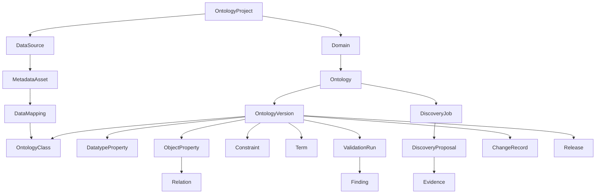

# P1 Ontology Meta-model Design

- Document: `docs/ontology/metamodel.md`
- Version: V1.0
- Date: 2026-11-21
- Status: Design Baseline
- Scope: P1 Ontology Engineering Platform MVP

## 1. Purpose

本文件定义 P1 平台内部统一元模型的对象边界、对象关系、字段约束、版本规则和扩展机制。

元模型的主要职责：

1. 统一管理项目、领域和本体资产。
2. 统一表达本体类、属性、关系、约束和术语。
3. 连接企业数据源及其元数据。
4. 管理 AI 发现任务、候选结果和来源证据。
5. 管理验证、变更、版本和发布记录。
6. 为 RDF、OWL、SHACL、SKOS、JSON Schema 等格式和标准提供映射基础。

本设计不将某一种外部本体标准直接作为平台唯一内部数据模型。

## 2. Modeling Boundaries

平台必须区分：

| Layer | Definition | Example |
|---|---|---|
| Platform Meta-model | 定义平台如何描述和管理语义资产 | Ontology、OntologyClass、OntologyVersion |
| Domain Ontology | 描述特定业务领域的概念和语义规则 | Customer、Order、Product |
| Instance Data | 按领域本体表达的具体业务对象 | C10001、O2026001 |

平台元模型属于平台基础能力；领域本体是平台管理的业务资产；实例数据可作为外部数据源或后续知识图谱能力接入。

## 3. Core Object Catalog

### 3.1 Project and Domain

| Object | Description | Key Relationships |
|---|---|---|
| OntologyProject | 工程项目及隔离边界 | contains Domains and Ontologies |
| Domain | 项目内的业务知识领域 | belongs to Project; contains Ontologies |

首期一个 Domain 只归属一个 Project。

### 3.2 Ontology Structure

| Object | Description | Key Relationships |
|---|---|---|
| Ontology | 持续演进的本体资产身份 | belongs to Domain |
| OntologyVersion | 不可变的本体版本快照 | belongs to Ontology |
| OntologyClass | 本体类 | belongs to OntologyVersion |
| DatatypeProperty | 数据类型属性 | references domain classes and datatype IRIs |
| ObjectProperty | 对象属性 | references domain and range classes |
| Relation | 本体关系的建模与呈现抽象 | maps to an ObjectProperty |
| Constraint | 本体或数据验证约束 | targets ontology elements or graphs |

Relation 与 ObjectProperty 不应重复持有同一语义定义。ObjectProperty 是标准语义对象；Relation 是平台建模层的关系表达，使用 objectPropertyId 或 predicateIri 建立映射。

### 3.3 Terminology

| Object | Description |
|---|---|
| Term | 标准化术语或概念词条 |
| Alias | 术语的替代标签、缩写或别名 |

Term 应支持多语言首选标签；Alias 必须关联 Term，并保留语言、类型和适用范围。

### 3.4 Data Source and Mapping

| Object | Description |
|---|---|
| DataSource | 外部数据库、文档库、API、代码库等数据源 |
| MetadataAsset | 从数据源采集的表、字段、Schema、文档等资产 |
| DataMapping | 元数据资产与本体对象之间的映射 |

连接凭据使用 Secret Reference。禁止在元模型记录、任务日志和导出文件中保存明文凭据。

### 3.5 Discovery and Evidence

| Object | Description |
|---|---|
| DiscoveryJob | 一次 AI 或规则驱动的本体发现任务 |
| DiscoveryProposal | 发现任务产生的候选类、属性、关系或映射 |
| Evidence | 候选结果的来源证据 |

DiscoveryProposal 是非正式候选资产。未经审核，不得直接修改正式 OntologyVersion。

### 3.6 Validation, Change and Release

| Object | Description |
|---|---|
| ValidationRun | 针对明确对象或版本的一次验证任务 |
| Finding | 验证发现的问题、警告或信息项 |
| ChangeRecord | 本体对象的新增、修改、删除和迁移记录 |
| Release | 对明确版本进行的发布记录 |

Release 必须引用一个确定的 OntologyVersion，并保留验证结果和制品引用。

## 4. Core Object Relationships



### 4.1 Relationship Rules

- Project contains one or more Domains.
- Domain belongs to exactly one Project.
- Ontology belongs to one Domain and one Project.
- Ontology has one or more versions over its lifecycle.
- OntologyVersion references one Ontology.
- Classes, properties, relations, terms and constraints belong to a version snapshot.
- DataSource and MetadataAsset carry project scope.
- DataMapping references a source MetadataAsset and a target semantic element.
- DiscoveryJob belongs to a project and may target an Ontology.
- DiscoveryProposal belongs to one DiscoveryJob.
- Evidence belongs to a proposal or an explicitly defined source record.
- ValidationRun references a draft workspace or an immutable OntologyVersion.
- Finding belongs to a ValidationRun.
- Release references one immutable OntologyVersion.

## 5. Identifier Strategy

P1 must distinguish three identifier categories:

| Identifier | Example | Purpose |
|---|---|---|
| Internal ID | UUID | Stable platform identity |
| Semantic IRI | `https://example.org/customer#Customer` | RDF/OWL semantic identity |
| Source ID | `crm.customer.customer_id` | External system identity |

Rules:

1. Internal IDs are immutable after creation.
2. Renaming an object must not regenerate its internal ID.
3. Changing a semantic IRI requires an explicit migration record.
4. Source IDs must be scoped by their DataSource.
5. IDs must not be reused after deletion.
6. Versioned semantic elements must preserve stable identity across versions when they represent the same continuing element.
7. If an element is replaced by a semantically different element, create a new identity and record the replacement relationship.

UUID is the MVP internal identifier baseline. IRI validation must use an IRI-aware validator; do not assume every valid IRI is necessarily accepted by a generic URL validator.

## 6. Common Fields

Project-scoped objects should include:

| Field | Type | Requirement |
|---|---|---|
| id | UUID | Required, immutable |
| projectId | UUID | Required |
| createdAt | DateTime | Required |
| updatedAt | DateTime | Required |
| createdBy | User ID | Required |
| updatedBy | User ID | Required |
| status | Enum | Required where lifecycle applies |
| extensions | JSON Object | Optional, namespaced |

Ontology-version-scoped semantic elements additionally include:

- ontologyId
- ontologyVersionId
- iri
- sourceRefs
- annotations

Do not force every common field onto every object. Each object schema defines its own required fields.

## 7. Versioning and Snapshot Rules

Ontology is the long-lived asset identity.

OntologyVersion is an immutable snapshot.

Draft editing must use a controlled workspace or draft revision. A published version cannot be modified in place.

A version snapshot should include:

- Schema version
- Ontology ID
- Project ID
- Version number
- Namespace declarations
- Classes
- Datatype properties
- Object properties
- Relations
- Constraints
- Terms and aliases
- Source and provenance references
- Snapshot creation metadata
- Content hash

Large source files and exported artifacts may be stored in object storage. The database stores their stable references and content hashes.

## 8. Cross-project Reference Rules

By default, internal object references must resolve within the same project.

The following must be rejected:

- Project A class references Project B property by internal ID.
- Project A mapping targets an unpublished Project B draft.
- A Release references a version owned by a different project without an authorized shared-asset relationship.

Cross-project reuse may be introduced through a dedicated shared-asset mechanism. It must reference a published immutable version and include explicit access authorization.

External IRIs are not internal object references and must be handled under a separate external-reference policy.

## 9. Object Lifecycle

### DiscoveryProposal

`pending → approved | rejected`

Approved proposals are converted into formal change commands. They are not directly written into a released version.

### ValidationRun

`queued → running → passed | failed | cancelled`

A validation run must record the target version or workspace revision, validator versions and ruleset versions.

### Release

`preparing → published → withdrawn`

A published release points to an immutable version. Withdrawal changes publication status; it does not mutate historical version content.

## 10. JSON Schema Policy

- Schema dialect: JSON Schema Draft 2020-12.
- Each schema has a stable `$id`.
- Reusable definitions are placed in `$defs` or shared schema documents.
- Core objects use `additionalProperties: false` unless an explicit extension point exists.
- Extensions are isolated under a namespaced `extensions` object.
- UUID, datetime, IRI and language tags require explicit format or custom validation.
- Format assertion must be enabled explicitly in the selected validator.
- Schema compatibility is tested before release.

JSON Schema validates the shape of an object. It does not replace database referential integrity, cross-project authorization, or ontology semantic validation.

## 11. Validation Responsibilities

| Validator | Responsibility |
|---|---|
| JSON Schema | Object structure, required fields and types |
| Pydantic | API and application model validation |
| Reference Validator | Object existence, project ownership and type correctness |
| Meta-model Validator | Internal model constraints and lifecycle rules |
| SHACL | RDF graph constraints |
| OWL tooling | Logical consistency and supported reasoning tasks |

SHACL and OWL checks serve different purposes. A successful SHACL run does not prove full OWL logical consistency, and the absence of OWL inconsistency does not prove that application data meets all business completeness requirements.

## 12. Extension Policy

Extensions must be namespaced and versioned.

Example:

```json
{
  "extensions": {
    "com.example.telecom": {
      "networkElementType": "router"
    }
  }
}
```

Extension fields must not override core fields or bypass access control.

Standards support should be added through adapters rather than by modifying core object semantics for every external format.

## 13. Backward Compatibility

| Change | Default Classification |
|---|---|
| Add optional field | Usually backward compatible |
| Add enum value | Potentially breaking for strict consumers |
| Change default behavior | Requires compatibility review |
| Change field type | Breaking |
| Remove field | Breaking |
| Change semantic meaning | Breaking |

Breaking changes require a new major schema version and an explicit migration.

## 14. Persistence Strategy

MVP persistence:

- PostgreSQL relational tables for core objects and references.
- JSONB for controlled extension payloads and variable provider metadata.
- S3-compatible object storage for large source files, immutable snapshots and exported artifacts.
- Content hashes for snapshot and artifact integrity.

A dedicated graph database is not a required dependency for the initial meta-model implementation.

## 15. Acceptance Criteria

### Schema Tests
- [ ] All core object schemas are valid Draft 2020-12 schemas.
- [ ] Valid objects pass.
- [ ] Invalid objects fail with useful paths and messages.
- [ ] Unknown core fields are rejected.
- [ ] Namespaced extensions are preserved.

### Identifier Tests
- [ ] Internal IDs remain unchanged after renaming.
- [ ] IRI migration creates a ChangeRecord.
- [ ] External source IDs are scoped to their DataSource.

### Reference Tests
- [ ] All internal references resolve.
- [ ] Reference target types are correct.
- [ ] Project IDs match.
- [ ] Unauthorized cross-project references are rejected.
- [ ] OntologyVersion references a valid Ontology.

### Version Tests
- [ ] Published versions are immutable.
- [ ] Release references a specific version.
- [ ] Snapshot hash remains stable.
- [ ] A new version can be compared with its predecessor.

### Interoperability Tests
- [ ] Import/export fixtures are available.
- [ ] Unsupported constructs generate warnings or errors.
- [ ] Round-trip tests compare semantic structures.
- [ ] Conversion losses are reported.

## 16. Implementation Status

This document is a design baseline. It does not imply that all objects, schemas, tables, validators or adapters have been implemented or accepted.
