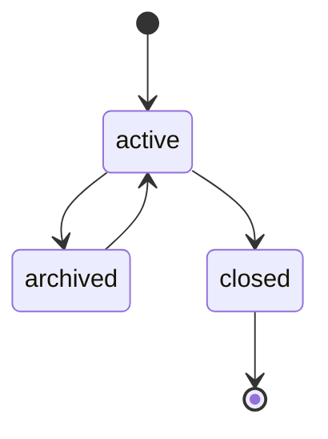
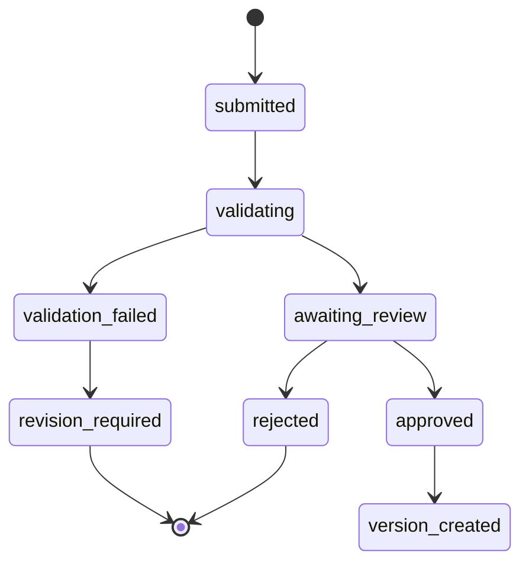
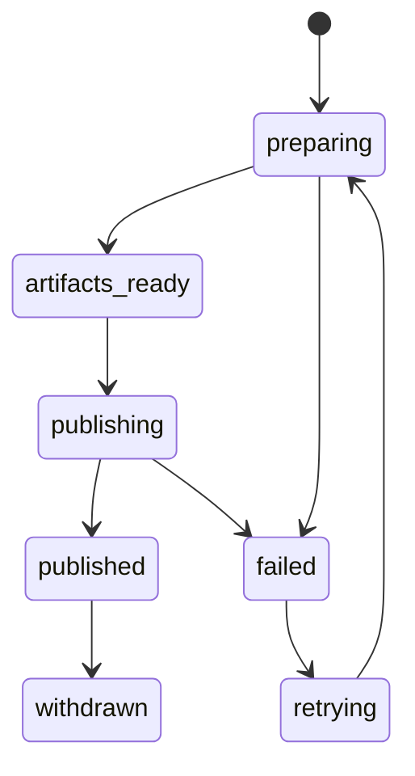

//
//  while.swift
//  
//
//  Created by joechen on 2026/11/21.
//

# P1 Ontology Versioning and Release Specification

- Document: `docs/ontology/versioning-and-release.md`
- Version: V1.0
- Date: 2026-11-21
- Status: Engineering Design Baseline
- Scope: P1 Ontology Engineering Platform

## 1. Purpose

本文档定义 P1 本体语义资产的工作区管理、版本控制、语义差异、兼容性判断、影响分析、发布和恢复机制。

设计目标：

1. 支持多人并行修改。
2. 支持可追踪的版本快照。
3. 支持结构化语义差异比较。
4. 支持兼容性判断和下游影响分析。
5. 支持候选审核和受控发布。
6. 支持发布失败恢复和历史版本恢复。
7. 保留完整审批、验证和审计证据。

## 2. Core Design Decisions

### 2.1 Separate Asset Identity, Version and Release

| Object | Meaning |
|---|---|
| Ontology | 持续演进的本体资产身份 |
| Workspace | 一组协作修改的工作区 |
| WorkspaceRevision | 工作区中的可追踪草稿修订 |
| CandidateSubmission | 冻结的候选快照及变更说明 |
| OntologyVersion | 审核通过后创建的不可变正式版本 |
| Release | 将某个正式版本发布到指定环境的记录 |
| ReleaseAttempt | 一次发布执行尝试 |
| ApprovalRecord | 人工审核和授权记录 |

同一 Ontology 可以拥有多个 Workspace、多个 OntologyVersion 和多个 Release。

同一个不可变 OntologyVersion 可以发布到多个环境，每次发布均创建独立 Release。

### 2.2 Workspace Is Not a Version

Workspace 是协作容器，不是正式版本。

Workspace 记录：

- `id`
- `projectId`
- `ontologyId`
- `name`
- `baseVersionId`
- `baseSnapshotHash`
- `headRevisionId`
- `status`
- `ownerId`
- `createdAt`
- `updatedAt`

Workspace 状态：

- `active`
- `archived`
- `closed`

### 2.3 Draft, Candidate and Published

| State | Mutability | Meaning |
|---|---|---|
| Draft | Mutable | 工作区正在编辑的内容 |
| Candidate | Immutable | 提交审核的冻结快照 |
| Validated | Immutable candidate result | 候选快照已通过规定验证 |
| Published | Immutable version/release | 正式版本已发布 |
| Deprecated | Immutable historical asset with lifecycle marker | 已废弃但保留历史记录 |

Candidate 内容冻结后不允许原地修改。修订应创建新的 WorkspaceRevision 和 CandidateSubmission。

Deprecated 是生命周期标记，不应通过修改历史快照实现。

## 3. State Machines

### 3.1 Workspace

### 3.2 Candidate Submission

### 3.3 Release

状态转换必须由服务层命令执行，并在事务内校验前置状态。

## 4. Versioning Strategy

### 4.1 Immutable Snapshot

每个正式版本必须具有完整、不可变快照。

快照最少包含：

- Project ID
- Ontology ID
- Version
- Schema Version
- Namespace Registry
- Classes
- Datatype Properties
- Object Properties
- Relations
- Constraints
- Terms and Aliases
- Semantic Axioms
- Opaque Constructs
- Provenance References
- Snapshot Metadata

正式版本应保存：

- `snapshotRef`
- `snapshotHash`
- `canonicalizationVersion`
- `schemaVersion`
- `createdAt`
- `createdBy`
- `parentVersionId`
- `candidateSubmissionId`

### 4.2 Snapshot Hash

Snapshot Hash 表示规范化语义快照内容的 SHA-256 摘要。

计算前必须排除不属于语义内容的易变信息，例如：

- 导出时间；
- API 请求 ID；
- 临时任务 ID；
- UI 展示状态；
- 文件生成路径；
- 不影响语义的运行时日志。

参与计算的内容应包括：

- 语义对象；
- 对象间引用；
- 语义公理；
- 约束定义；
- 命名空间；
- 需要版本化的来源引用；
- 扩展数据。

RDF Dataset 应使用能够稳定处理 Blank Nodes 的规范化算法。不能简单地对原始三元组文本排序后计算哈希。

### 4.3 Snapshot Hash and Artifact Hash

| Hash | Purpose |
|---|---|
| Snapshot Hash | 识别内部语义快照内容 |
| Artifact Hash | 识别实际导出文件字节内容 |

同一版本采用不同 Serializer 或格式时，Artifact Hash 可以不同；Snapshot Hash 应保持不变。

### 4.4 Version Number

采用 SemVer 风格版本号：

`MAJOR.MINOR.PATCH`

建议的初始策略：

- MAJOR：存在已确认的破坏性语义变更；
- MINOR：增加向后兼容的语义能力；
- PATCH：修正不改变语义含义的元数据或文档内容。

版本号由发布负责人确认。Semantic Diff 只提供建议，不自动替代兼容性判断。

## 5. Semantic Diff

### 5.1 Diff Categories

| Category | Examples |
|---|---|
| Class | Added, Removed, Renamed, Definition Changed |
| Class Hierarchy | Parent Added, Parent Removed |
| Datatype Property | Added, Removed, Datatype Changed |
| Object Property | Added, Removed, Domain/Range Changed |
| Relation | Added, Removed, Endpoint Changed |
| Constraint | Added, Removed, Expression Changed |
| Term | Label, Definition, Alias Changed |
| Namespace | Prefix or Namespace IRI Changed |
| Semantic Axiom | Added, Removed, Modified |
| Opaque Construct | Added, Removed, Changed |

### 5.2 Object Identity

Semantic Diff should match objects by stable internal ID first.

For imported objects without stable IDs, use the source mapping registry or semantic IRI as a controlled fallback.

Changing a semantic IRI must be reported explicitly, even when the internal ID remains unchanged.

### 5.3 Compatibility Classification

Each change item contains:

- `changeType`
- `targetId`
- `targetIri`
- `impactLevel`
- `compatibility`
- `migrationRequired`
- `rationale`
- `oldValue`
- `newValue`

Compatibility values:

- `compatible`
- `conditionally_compatible`
- `breaking`
- `unknown`

Impact levels:

- `none`
- `low`
- `medium`
- `high`
- `critical`

Unknown compatibility must not be silently converted into compatible.

## 6. Branch and Merge

### 6.1 Branch Creation

A new Workspace must pin:

- Base Version ID
- Base Snapshot Hash
- Base Revision

### 6.2 Three-way Merge

Merge uses:

- Base: common ancestor snapshot
- Source: modified branch snapshot
- Target: current target branch snapshot

Auto-merge may apply independent changes.

Conflict examples:

- Both branches modify the same property datatype.
- One branch deletes a class while another adds a property referencing it.
- Both branches change ObjectProperty domain/range.
- A class hierarchy change introduces a cycle.
- SHACL constraint changes conflict.
- Namespace changes affect the same IRI family.

Conflicts must be represented explicitly and resolved by an authorized user.

A raw RDF triple union is not a semantic merge algorithm.

### 6.3 Optimistic Concurrency

Workspace updates must include an expected revision or ETag.

If the current revision differs from the caller's expected revision, reject the update with a conflict response and require reload/rebase.

## 7. Release Pipeline

Recommended flow:

1. Submit CandidateSubmission.
2. Freeze candidate snapshot.
3. Compute Semantic Diff.
4. Run structural and semantic validation.
5. Run dependency impact analysis.
6. Obtain required approvals.
7. Create immutable OntologyVersion.
8. Generate release artifacts.
9. Verify artifact hashes.
10. Publish to the target environment.
11. Update the active version pointer.
12. Write audit and outbox events.

Validation results must be bound to the exact candidate snapshot hash.

Any change to the candidate content invalidates the previous validation result.

## 8. Release Transaction Strategy

Object storage and relational database do not share a transaction.

Use a staged publication design:

### Phase A: Prepare

- Create ReleaseAttempt.
- Generate artifacts.
- Upload to immutable, version-specific object keys.
- Verify artifact hashes.
- Mark artifacts as ready.

### Phase B: Commit

Inside one database transaction:

- Confirm the expected active version has not changed.
- Create or finalize Release.
- Update the target environment's active version pointer.
- Insert an Outbox event.
- Commit.

An Outbox Relay publishes downstream notifications after commit.

If the database transaction fails, the active version pointer remains unchanged. Uploaded but unreferenced artifacts are eligible for controlled garbage collection after a retention interval.

### 8.1 Idempotency

Publish commands must include an idempotency key.

Repeated requests with the same key and same payload return the same operation result.

A repeated key with a different payload must be rejected.

## 9. Rollback and Recovery

Rollback creates a new Release event that points to a previously published immutable version.

It must not:

- Rewrite old snapshots;
- Delete the failed Release;
- Reuse an old Release ID;
- Bypass current authorization;
- Skip required compatibility and validation checks.

Recovery sequence:

1. Select the target historical version.
2. Check artifact availability and integrity.
3. Re-run policy-required verification.
4. Obtain rollback authorization.
5. Create a new ReleaseAttempt.
6. Publish the historical version to the target environment.
7. Update the active version pointer atomically.
8. Record a rollback audit event.

## 10. Impact Analysis

Impact analysis combines Semantic Diff and Dependency Registry.

Dependency categories:

- Ontology class/property references
- DataMappings
- SHACL constraints
- Other ontology imports
- API and schema contracts
- Registered downstream applications
- Agent/skill semantic dependencies
- Exported artifacts and cached semantic representations

The report includes:

- changed elements;
- directly affected elements;
- transitively affected applications;
- required revalidation;
- migration tasks;
- dependency coverage;
- unresolved external dependencies;
- confidence and limitations.

The platform must distinguish “no known dependent” from “dependency inventory complete and no dependent found”.

## 11. Permissions and Separation of Duties

Recommended permissions:

| Permission | Description |
|---|---|
| ontology.read | Read ontology and versions |
| workspace.create | Create a workspace |
| ontology.edit | Edit a draft |
| candidate.submit | Submit a candidate |
| candidate.review | Approve or reject a candidate |
| version.create | Create an immutable version |
| release.publish | Publish a version |
| release.withdraw | Withdraw a release |
| release.rollback | Restore a previous version |
| dependency.manage | Manage downstream dependencies |
| approval.configure | Configure approval policies |

Backend services must perform authorization checks.

High-risk production changes should support separation of duties between submitter, domain reviewer and release manager.

AI agents may prepare candidates, diffs and reports but cannot self-authorize formal approval or production publication.

## 12. Audit Model

Audit events should record:

- actor ID and actor type;
- project and ontology IDs;
- workspace, candidate, version and release IDs;
- action and target;
- previous and new state;
- reason;
- timestamp;
- request/correlation ID;
- approval references;
- content hash.

Audit storage must have restricted update/delete access and an appropriate retention policy.

## 13. Suggested Services

| Service | Responsibility |
|---|---|
| Workspace Service | Branch and collaborative editing |
| Version Service | Candidate, snapshot, version creation and retrieval |
| Semantic Diff Service | Object and axiom comparison |
| Compatibility Service | Compatibility classification |
| Impact Analysis Service | Dependency traversal |
| Approval Service | Review workflow and separation of duties |
| Release Service | Artifact generation and publication |
| Recovery Service | Retry, rollback and recovery |
| Audit Service | Append-only lifecycle events |

## 14. API Baseline

| Method | Endpoint | Purpose |
|---|---|---|
| POST | `/ontologies/{id}/workspaces` | Create workspace |
| GET | `/workspaces/{id}` | Get workspace |
| PUT | `/workspaces/{id}/draft` | Update draft with expected revision |
| POST | `/workspaces/{id}/candidates` | Freeze and submit candidate |
| GET | `/candidates/{id}/diff` | Get semantic diff |
| POST | `/candidates/{id}/validate` | Run validation |
| POST | `/candidates/{id}/impact-analysis` | Analyze dependencies |
| POST | `/candidates/{id}/approvals` | Record review decision |
| POST | `/candidates/{id}/versions` | Create immutable version |
| POST | `/versions/{id}/releases` | Publish version |
| POST | `/releases/{id}/rollback` | Create rollback release |
| GET | `/ontologies/{id}/versions` | List versions |
| GET | `/releases/{id}` | Get release status |

Long-running validation and release operations should return Job or Operation IDs.

## 15. Acceptance Criteria

### Snapshot
- [ ] Snapshot content is immutable.
- [ ] Snapshot hash is reproducible.
- [ ] Volatile operational fields do not alter semantic hash.
- [ ] RDF blank nodes are handled by graph-aware canonicalization.

### Semantic Diff
- [ ] Added and removed classes are identified.
- [ ] Property datatype, domain and range changes are identified.
- [ ] Class hierarchy changes are identified.
- [ ] Constraint changes are identified.
- [ ] IRI changes are distinguished from label changes.
- [ ] Unknown constructs are reported as unknown, not compatible.

### Workspace and Merge
- [ ] Workspace pins its base version and hash.
- [ ] Stale revisions are rejected.
- [ ] Independent changes can be merged.
- [ ] Conflicting semantic edits require resolution.
- [ ] Merge output passes reference and semantic validation.

### Release
- [ ] Candidate snapshot is frozen.
- [ ] Validation result is bound to the snapshot hash.
- [ ] Approval policy is enforced.
- [ ] Release artifact hash is verified.
- [ ] Active version pointer updates atomically.
- [ ] Publish commands are idempotent.
- [ ] Failure leaves the previous active version unchanged.

### Recovery
- [ ] Historical snapshot can be retrieved.
- [ ] Rollback creates a new Release record.
- [ ] Existing Release history remains unchanged.
- [ ] Rollback is authorized and audited.

## 16. Implementation Status

This document is the V1.0 lifecycle-management design baseline. Implementation, integration testing, deployment and production acceptance must be recorded separately.